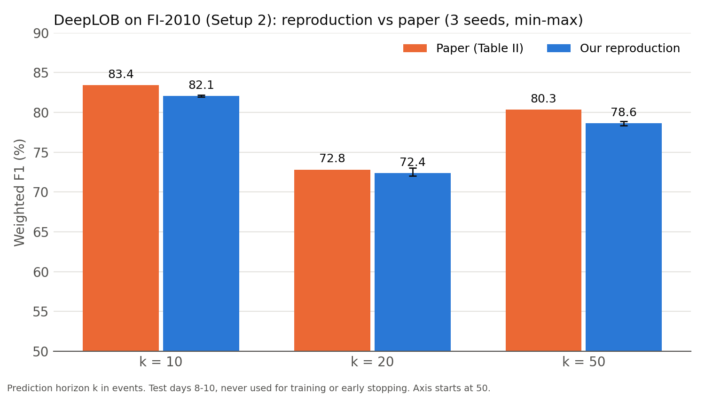
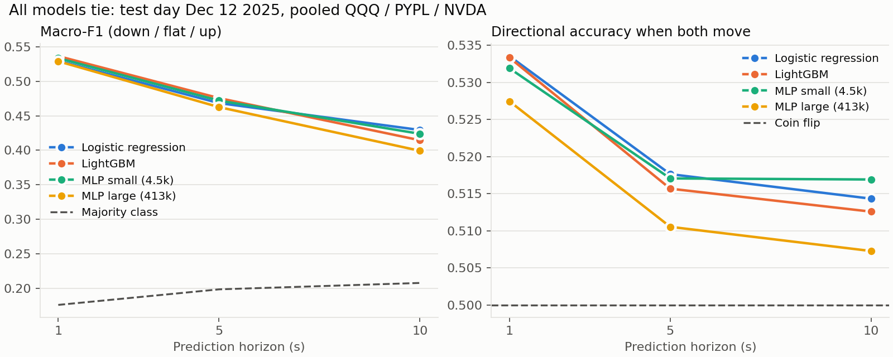
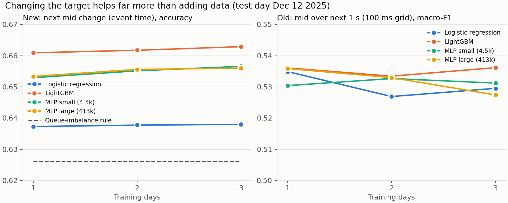
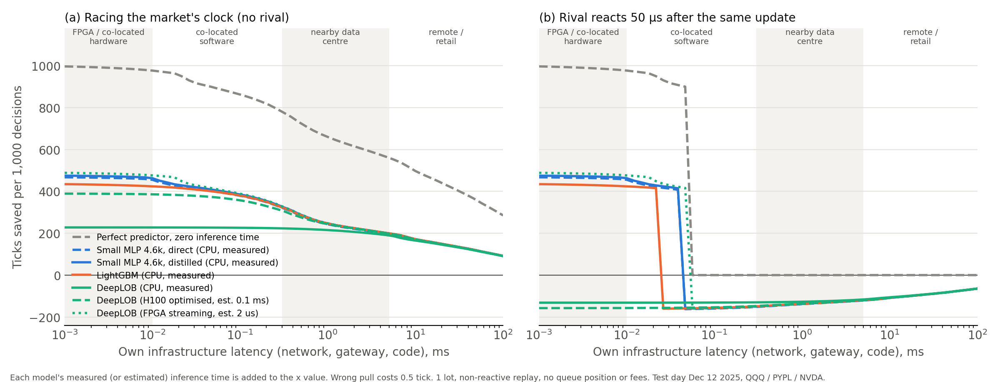

# Fast Enough to Matter: Distilling Order-Book Models for Low-Latency Market Making

STAT UN3108: Applied Deep Learning and AI, Columbia University, Fall 2026

**Group members:** Jack Fanshawe (add others)

## 1. Introduction

This repository reproduces DeepLOB and asks whether its predictive edge survives the latency constraints of market making.

- **Setting:** a software market maker on a CPU server near the exchange: no FPGA, and no GPU on the decision path (one-at-a-time GPU inference is measurably slower than CPU). It predicts the direction of the next mid-price change on Nasdaq and pulls the quote that is about to be run over.
- **The tension:** on our Nasdaq data the next mid change arrives a median 2-26 ms after a book update (QQQ, NVDA). DeepLOB takes ~2 ms per prediction on one CPU thread (the paper's 0.253 ms is a batched GPU figure); a 4.6k-parameter MLP student takes ~0.01 ms.
- **The question:** how much of each model's edge is left once its own inference time is charged, and can a fast student distilled from a slow teacher keep it?
- **The answer depends on the competitive environment.** Speed only matters relative to whoever else is racing for the same price change, so results are reported as curves against total latency (own infrastructure + model), with and without a faster rival, rather than as one profit number. Readers place themselves on the curve (FPGA shop, co-located software, nearby data centre, retail).

- **Selected paper:** Z. Zhang, S. Zohren, S. Roberts, *DeepLOB: Deep Convolutional Neural Networks for Limit Order Books*, IEEE Transactions on Signal Processing, 2019 ([arXiv 1808.03668](https://arxiv.org/abs/1808.03668)).
- **Main contribution of the paper:** a CNN + inception + LSTM network that learns features directly from raw limit-order-book snapshots and predicts mid-price direction, beating hand-crafted-feature models on the FI-2010 benchmark and transferring to unseen LSE stocks.

## 2. Live Demo (optional)

TODO: link to deployed demo and setup steps, if any.

## 3. Chosen Result

- **Result targeted for reproduction:** DeepLOB accuracy / precision / recall / F1 on FI-2010, Setup 2 (train days 1-7, test days 8-10), prediction horizons k = 10, 20, 50. Paper F1: 83.40 / 72.82 / 80.35 %.
- **Why it matters:** it is the paper's headline evidence that a deep model on raw book data beats feature-based models; our extension asks whether that advantage still holds on recent Nasdaq data, against strong tree baselines, and after latency is charged.
- **Reference in original paper:** Table II (Setup 2). Table I (Setup 1, anchored 9-fold, k = 10, 50, 100) is a possible second target; Table III reports DeepLOB's forward time (0.253 ms, GPU).

## 4. GitHub Contents

| Path | Contents |
|------|----------|
| `README.md` | This file |
| `code/` | Re-implementation code, configs, and scripts |
| `data/` | Datasets, or a README on how to obtain them |
| `results/` | Generated figures, tables, and logs |
| `poster/` | PDF of the poster presented in class |
| `report/` | PDF of the final two-page report |
| `LICENSE` | MIT License |
| `.gitignore` | Files ignored by Git |
| `code/data/` | ITCH download, parser, order-book rebuild, features (`download_itch.py`, `itch_parse.py`, `book.py`, `features.py`, `select_symbols.py`) |
| `deeplob_reproduction/` | **DeepLOB reproduction on FI-2010** (paper Table II): model, training script, results, figure, own README |
| `code/models/` | Baselines (`baselines.py`), MLPs (`mlp.py`), learning curve (`learning_curve.py`), batch-1 latency (`latency.py`), DeepLOB on Nasdaq (`train_deeplob_itch.py`), saved test predictions (`save_predictions.py`), distillation (`distill.py`) |
| `code/sim/` | Latency-aware market-making simulator (`latency_sim.py`) |
| `code/run_overnight.sh` | Low-priority queue for the long GPU runs |
| `code/analysis/` | Figures (`plot_baselines.py`, `plot_learning_curve.py`) |
| `research/` | Literature notes and the implementation plan |
| `Propsoal.md` | Initial project proposal (superseded by `research/implementation_plan.md`) |
| `ProgressTracker.md` | Dated progress log |

## 5. Re-implementation Details

- **Approach:** (1) reproduce DeepLOB on FI-2010 (done, `deeplob_reproduction/`); (2) rebuild the full Nasdaq order book from raw ITCH messages and predict the direction of the next mid change at every best bid/ask update, one model pooled across stocks (the first 100 ms / 1-10 s grid target carried almost no signal); (3) train DeepLOB on the raw 100-update window as the slow teacher; (4) distil it into a small student; (5) measure every model's batch-1 latency; (6) charge that latency in a simple market-making simulator, sweeping own and rival latency.
- **Models:** queue-imbalance rule, logistic regression and LightGBM baselines; DeepLOB (61.6k params, 24.5M FLOPs per prediction) and a large MLP as teachers; a 4.6k-parameter MLP student (direct vs distilled). DeepLOB is small in parameters but slow: its LSTM runs 100 steps in sequence.
- **Simulator (`code/sim/latency_sim.py`):** at each decision the model predicts the next mid move and pulls the quote about to be run over: +1 tick if right and in time, -c ticks if wrong and in time, 0 if the move came first. Time to the next move is taken from the data; an optional rival reacting after R us takes correct opportunities first. One lot, non-reactive replay, no queue position or fees: it shows the latency effect, not realistic PnL. hftbacktest remains an optional, more realistic check.
- **Datasets:** FI-2010; free Nasdaq TotalView-ITCH 5.0 files for Dec 8-12 2025 (QQQ + two mid-liquidity stocks). See `data/README.md`.
- **Evaluation metrics:** accuracy, AUC, macro-F1; batch-1 inference latency (p50/p99, CPU and GPU); simulated ticks saved per 1,000 decisions vs total latency, with and without a rival.
- **Challenges / modifications to the original:** unsmoothed labels (smoothed FI-2010-style labels leak future prices); chronological day-level splits; latency charged per model.

## 6. Reproduction Steps

```bash
git clone <repo-url> && cd DeepLearningAIProjet
pip install -r requirements.txt
export HFT_DATA_DIR=/path/to/external/drive/hft_data      # ~50 GB free needed for the raw week
bash code/run_pipeline.sh                                  # download, parse, rebuild books, features
python code/models/baselines.py                            # linear + LightGBM baselines -> results/baselines/
python code/data/book_events.py 2025-12-08 2025-12-09 2025-12-10 2025-12-11 2025-12-12   # event-time books (10 levels)
python code/data/features_event.py 2025-12-08 2025-12-09 2025-12-10 2025-12-11 2025-12-12
python code/models/latency.py --family torch && python code/models/latency.py --family lgbm
python code/models/train_deeplob_itch.py                   # DeepLOB on Nasdaq (~4 h on an M1 Max GPU)
python code/models/save_predictions.py --family trees && python code/models/save_predictions.py --family mlp
python code/models/distill.py --stage teacher_lgbm && python code/models/distill.py --stage distill
python code/sim/latency_sim.py                             # -> results/sim/latency_sim.{json,png}
```

DeepLOB on FI-2010: see [deeplob_reproduction/README.md](deeplob_reproduction/README.md).

- **Compute requirements:** any recent laptop. Developed on an Apple M1 Max (64 GB RAM). Parsing is ~5 min per day; baselines take minutes; DeepLOB training ~2-4 h on the Apple GPU.

## 7. Results / Insights

**DeepLOB reproduction (2026-11-16).** FI-2010 Setup 2, weighted F1 82.1 / 72.1 / 78.3 vs the paper's
83.4 / 72.8 / 80.4 at k = 10 / 20 / 50 (within 0.7-2.1 points). Details, gap analysis and run instructions:
[deeplob_reproduction/README.md](deeplob_reproduction/README.md).



**Baselines (2026-11-03)**, pooled over QQQ, PYPL and NVDA, test day Dec 12 2025. Full write-up: [results/baseline_results.md](results/baseline_results.md).

| Horizon | Majority class | Logistic | LightGBM | MLP small (4.5k) | MLP large (413k) |
|---|---|---|---|---|---|
| 1 s | 0.18 | 0.53 | 0.54 | 0.53 | 0.53 |
| 5 s | 0.20 | 0.47 | 0.48 | 0.47 | 0.46 |
| 10 s | 0.21 | 0.43 | 0.42 | 0.42 | 0.40 |

*(macro-F1, down / flat / up)*



All learned models tie, and the large MLP is never better than the small one. Most of the gain is in predicting
*whether* the mid moves, not its direction (directional accuracy 0.53 at 1 s).

**Event-time target (2026-11-03).** Predicting the direction of the *next* mid change, sampled at every best
bid/ask update, lifts test accuracy to 0.66 (LightGBM 0.663, MLP 0.657, logistic 0.638, one-feature
queue-imbalance rule 0.626). Training on 1 → 3 days adds only 0.2–0.4 points. Model size still makes no
difference. The next mid change arrives a median 2–26 ms later for QQQ and NVDA, so latency matters directly.
Write-up: [results/event_time_results.md](results/event_time_results.md).



**Inference latency (2026-11-16)**, batch 1, Apple M1 Max (`results/latency/latency.json`): student MLP 0.011 ms,
LightGBM ~0.027 ms (incl. Python call), large MLP 0.03 ms, DeepLOB 1.8-2.1 ms on one CPU thread and ~5 ms on the
GPU one at a time; batched on the GPU DeepLOB is 0.19 ms per prediction, matching the paper's 0.253 ms. For 45% of
QQQ decision rows the next mid change arrives within 2 ms, i.e. before DeepLOB's answer; for the student, 2%.

**DeepLOB on Nasdaq + latency simulator (2026-11-16).** On the test day DeepLOB (raw book) reaches 0.663
accuracy, tying LightGBM (0.663, hand-made features) and beating the small MLP (0.657) by 0.66 points
[95% CI +0.50, +0.82]; averaging DeepLOB and LightGBM gives 0.671. But charged its 1.76 ms CPU inference in the
simulator, DeepLOB keeps about half the small MLP's value at co-located speeds (228 vs 455 ticks saved per 1,000
decisions at 10 us own latency); only FPGA-class inference (estimated) would let its edge pay. Write-up:
[results/deeplob_itch_results.md](results/deeplob_itch_results.md).



**Distillation (2026-11-16).** Training the same 4.6k-parameter MLP on LightGBM's (cross-fitted) soft labels
lifts it from 0.657 to 0.662 test accuracy (3 seeds, ranges do not overlap), closing ~80% of the gap to
LightGBM at 10 us instead of 27 us; in the simulator it becomes the best CPU model at every own latency up to
~1 ms. DeepLOB as teacher helps far less (0.658): its edge comes from raw-book patterns the student's features
cannot express, so the most accurate teacher is not the most useful one. Write-up:
[results/distill_results.md](results/distill_results.md).

## 8. Conclusion

TODO: key takeaways and lessons learned.

## 9. References

1. TODO: original paper
2. TODO: tools, datasets, frameworks

## 10. Acknowledgements

This work was completed as part of the STAT UN3108 Applied Deep Learning and AI course at Columbia University (Fall 2026), taught by Kenta Takatsu and Chen Wang.
