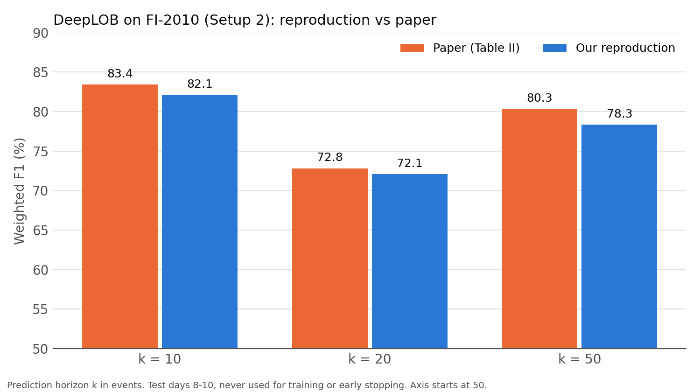

# DeepLOB Reproduction (FI-2010, Setup 2)

Self-contained reproduction of the anchor paper's headline FI-2010 result. The rest of the repository
(Nasdaq ITCH pipeline, baselines, distillation, latency) builds on it.

**Paper:** Z. Zhang, S. Zohren, S. Roberts, *DeepLOB: Deep Convolutional Neural Networks for Limit Order
Books*, IEEE Transactions on Signal Processing 67(11), 2019. [arXiv 1808.03668](https://arxiv.org/abs/1808.03668).
The PDF is not redistributed here; read it on arXiv.

## What the paper does

DeepLOB predicts whether the mid-price will go down, stay flat or go up k events ahead, straight from the
raw limit order book. The input is the last 100 snapshots of the top 10 price levels on each side (a
100 × 40 "space-time image" of price and size). Three convolutional blocks learn to combine price with
size, then bid with ask (a learned micro-price), then all 10 levels; an inception module looks at several
time scales at once; an LSTM(64) carries memory across the 100 steps. On FI-2010 it beat every earlier
method, it transferred to London stocks it never saw, and the paper argues it is fast enough for HFT
(0.253 ms per forward pass, Table III).

## Result reproduced

**Table II (FI-2010 Setup 2): train on days 1-7, test on days 8-10, horizons k = 10, 20, 50.**



| k | | Accuracy | Precision | Recall | F1 (weighted) | F1 (macro) |
|---|---|---|---|---|---|---|
| 10 | Paper | 84.47 | 84.00 | 84.47 | 83.40 | – |
| 10 | **Ours** | **83.06** | 82.17 | 83.06 | **82.10** | 72.13 |
| 20 | Paper | 74.85 | 74.06 | 74.85 | 72.82 | – |
| 20 | **Ours** | **73.73** | 72.38 | 73.73 | **72.11** | 63.61 |
| 50 | Paper | 80.51 | 80.38 | 80.51 | 80.35 | – |
| 50 | **Ours** | **78.38** | 78.33 | 78.38 | **78.32** | 76.74 |

Single seed (0), decimal-precision files. **Reproduced within 0.7-2.1 F1 points at every horizon**,
including the paper's non-monotone pattern (k = 20 is the hardest). Best epoch 34 / 36 / 26, stopped at
55 / 57 / 47 (paper: "about 100 epochs"). Test class balance (down / stationary / up): k=10
0.15 / 0.71 / 0.14, k=20 0.20 / 0.62 / 0.18, k=50 0.28 / 0.47 / 0.25.

### Latency: the paper's 0.253 ms vs what a trader gets

From `code/models/latency.py` (results in `results/latency/latency.json`), same 61.6k-parameter model,
Apple M1 Max:

| How DeepLOB is run | Time per prediction |
|---|---|
| Paper, Table III (NVIDIA P100 GPU, method not stated) | 0.253 ms |
| Ours: GPU, batch of 32 divided by 32 (throughput) | 0.19 ms |
| Ours: CPU, 1 thread, one prediction per book update | 1.8-2.1 ms |
| Ours: GPU, one prediction per book update | ~5 ms |

The batched number matches the paper's, which suggests Table III reports throughput. A live trader
predicts one book update at a time, where DeepLOB takes ~2 ms: about the median time to the next mid
change for QQQ in our Nasdaq data. Batch-1 latency on an NVIDIA GPU is still to be measured.

## Sources of the remaining gap

| Possible cause | Detail | Expected effect |
|---|---|---|
| Normalisation | Paper used the z-score FI-2010 files; we used decimal precision (the version the authors' repo ships). Paper: "subtle difference". | Small; being tested (`--norm ZScore`) |
| Single seed | One run per horizon; DeepLOB results vary between seeds. | Being tested (3 seeds) |
| Validation split | Paper does not say where its FI-2010 validation set comes from. We follow the authors' code: last 20% of days 1-7 held out, so we train on 80% of the training data. | Slightly lower |
| Framework defaults | Paper used Keras/TensorFlow; we use PyTorch (weight initialisation, BatchNorm momentum and epsilon, Adam epsilon semantics differ). | Small, unknown sign |
| Architecture details | The paper's text says Leaky-ReLU everywhere; the authors' code uses tanh in the second conv block (we follow the code). Paper says zero padding on every conv; we pad the time axis only. | Small |
| Window boundaries | As in the authors' code, input windows are built over the concatenated file and can span a stock or day boundary (a few hundred of ~250k windows). | Negligible |
| Metric definition | Paper's precision / recall / F1 are weighted averages (recall equals accuracy in every row of Table II). Using macro F1 instead would look 1-11 points worse; we compare weighted to weighted. | None once matched |

## Caveats carried over from the paper's setup

- FI-2010 labels compare the mean of the next k mid-prices with the current one (paper eq. 3), so they use
  future information and are not directly tradable. Our Nasdaq extension uses unsmoothed labels.
- FI-2010 is small and old: 5 Finnish stocks, 10 days in June 2010, one snapshot per 10 events.

## How to run

**Requirements:** Python 3.11, `numpy`, `torch` (>= 2.3), `scikit-learn`, `matplotlib`
(all in the repository's `requirements.txt`). An Apple-silicon GPU (MPS) or CUDA GPU is strongly
recommended: one run takes ~2 h on an M1 Max GPU, ~20x longer on CPU.

**Data** (~1 GB unpacked; FI-2010, CC BY 4.0, authors' preprocessed copy):

```bash
export FI2010_DIR=/path/to/fi2010
mkdir -p $FI2010_DIR && cd $FI2010_DIR
curl -LO https://raw.githubusercontent.com/zcakhaa/DeepLOB-Deep-Convolutional-Neural-Networks-for-Limit-Order-Books/master/data/data.zip
unzip data.zip   # Train_Dst_NoAuction_DecPre_CF_7.txt, Test_Dst_NoAuction_DecPre_CF_{7,8,9}.txt
```

For the z-score files, download the original FI-2010 release from the
[dataset record](https://etsin.fairdata.fi/dataset/73eb48d7-4dbc-4a10-a52a-da745b47a649) and put
`*_NoAuction_ZScore_CF_{7,8,9}.txt` in the same folder.

**Train and evaluate** (from the repository root):

```bash
python deeplob_reproduction/train_fi2010.py --k 10                # one horizon, paper settings
python deeplob_reproduction/train_fi2010.py --k 20 --max-epochs 1 # smoke test (~2 min)
python deeplob_reproduction/train_fi2010.py --k 50 --seed 1       # another seed
python deeplob_reproduction/train_fi2010.py --k 10 --norm ZScore  # paper's normalisation
python deeplob_reproduction/plot_results.py                       # figure (mean and range over seeds)
```

Options: `--variant repo` (the larger 144k-parameter model from the authors' later notebook),
`--threads` (CPU threads, default 2), `--data-dir`. Each run prints test accuracy / P / R / F1 next to the
paper's numbers and writes `results/deeplob_k<k>[_zscore][_seed<n>].json` with the per-epoch history;
weights go to the data folder.

## Files

| File | Contents |
|---|---|
| `deeplob.py` | DeepLOB model: paper size (61.6k params, default) and the authors' notebook size |
| `train_fi2010.py` | Data loading, Setup 2 split, training with early stopping, blind test evaluation |
| `plot_results.py` | Reproduction-vs-paper figure |
| `results/deeplob_k{10,20,50}.json` | Test metrics, confusion matrices, settings, per-epoch history |
| `results/fi2010_vs_paper.png` | Figure above |

## Settings used

| | Paper (Sec. V-A) | Ours |
|---|---|---|
| Model | conv 16 filters, Inception@32, LSTM 64, ~60k params | same, 61,555 params |
| Optimiser | Adam, lr 0.01, epsilon 1 | same |
| Batch size | 32 | 32 |
| Early stopping | validation accuracy, patience 20 | same; validation = last 20% of days 1-7 |
| Input | last 100 events × 40 (10 levels) | same |
| Data | FI-2010, no auction, z-score | FI-2010, no auction, decimal precision |
| Hardware | NVIDIA Tesla P100, Keras | Apple M1 Max GPU (MPS), PyTorch 2.11 |
