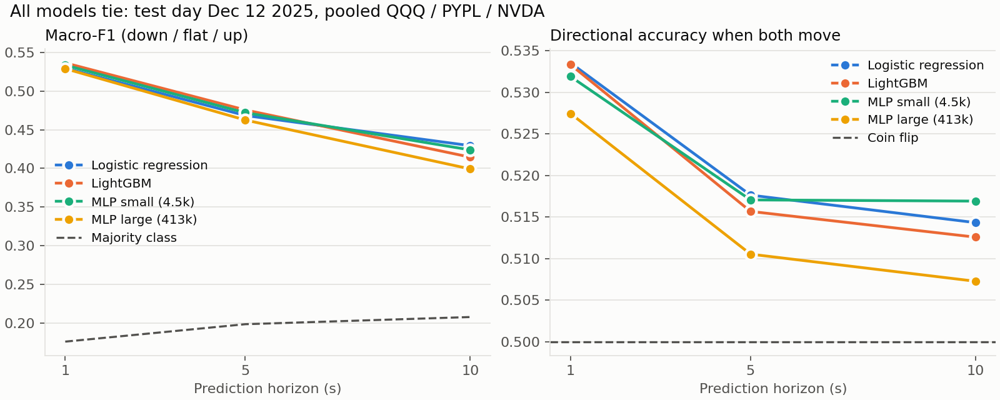

# Baseline Results: Mid-Price Direction on Nasdaq ITCH

*2026-11-03. Code: `code/models/baselines.py`, `code/models/mlp.py`, `code/analysis/plot_baselines.py`.
Raw numbers: `baselines/metrics.json`, `nn/metrics.json`.*

## Setup

- **Data:** Nasdaq TotalView-ITCH 5.0, full order book rebuilt from every message and sampled every 100 ms,
  09:35–15:55 ET. QQQ, PYPL and NVDA, pooled into one model (symbol id as an input).
- **Split (chronological):** train Dec 8–10 2025 (2.05M rows), validate Dec 11 (684k; early stopping only),
  test Dec 12 (684k).
- **Task:** mid-price change over 1 s, 5 s, 10 s → down / flat / up. No label smoothing.
- **Inputs:** 31 scale-free features (spread, queue and depth imbalance, microprice deviation, order-flow
  imbalance, returns, recent movement, trade-flow imbalance, relative volume and activity, time of day) + symbol.
- **Models:** majority class; multinomial logistic regression; LightGBM (early-stopped); MLP small
  (64-32, 4.5k params); MLP large (512-512-256, 413k params, dropout 0.1). MLPs: AdamW, cosine LR,
  early stopping on validation loss (patience 3).

## Test-day results (Dec 12 2025)

| Horizon | Model | Accuracy | Macro-F1 | Dir. acc. when both move | Log-loss |
|---|---|---|---|---|---|
| 1 s | Majority class | 0.359 | 0.176 | – | – |
| 1 s | Logistic regression | 0.548 | 0.530 | 0.534 | – |
| 1 s | LightGBM | **0.549** | **0.536** | 0.533 | **0.888** |
| 1 s | MLP small | 0.548 | 0.533 | 0.532 | 0.893 |
| 1 s | MLP large | 0.545 | 0.529 | 0.527 | 0.892 |
| 5 s | Majority class | 0.425 | 0.199 | – | – |
| 5 s | Logistic regression | 0.463 | 0.468 | **0.518** | – |
| 5 s | LightGBM | **0.469** | **0.476** | 0.516 | **0.931** |
| 5 s | MLP small | 0.467 | 0.472 | 0.517 | 0.937 |
| 5 s | MLP large | 0.460 | 0.463 | 0.511 | 0.939 |
| 10 s | Majority class | 0.453 | 0.208 | – | – |
| 10 s | Logistic regression | 0.458 | **0.429** | 0.514 | – |
| 10 s | LightGBM | **0.461** | 0.415 | 0.513 | **0.907** |
| 10 s | MLP small | 0.458 | 0.424 | **0.517** | 0.910 |
| 10 s | MLP large | 0.451 | 0.399 | 0.507 | 0.921 |

Test class balance (down / flat / up): 1 s 0.33 / 0.36 / 0.31; 5 s 0.42 / 0.17 / 0.41; 10 s 0.45 / 0.11 / 0.44.

**Per-symbol macro-F1 at 1 s:** QQQ 0.33–0.34, PYPL 0.29, NVDA 0.41–0.42 for every model. Within a single
stock, QQQ is at chance level.

**Regression variant (information coefficient, corr. of predicted vs realised mid change):** 1 s: ridge 0.044,
LightGBM 0.054; 5 s and 10 s: 0.01–0.03.

**Inference latency (batch 1, single CPU thread, PyTorch eager, M1 Max):** MLP small p50 21 µs;
MLP large p50 54 µs. Eager PyTorch is mostly framework overhead; a hand-written C student will be far faster.
LightGBM and logistic latency not yet measured.

## What this says

1. **All models tie.** The four learned models are within 0.01 macro-F1 of each other at every horizon.
   LightGBM is marginally best on log-loss; the 413k-param MLP is never better than the 4.5k one and
   reaches its best validation loss after 1–2 epochs, then overfits. On this task, **gate 1 fails: extra
   capacity buys nothing**, matching Briola et al. (2020) and TLOB (2025).
2. **The gain over the majority class is mostly "will it move", not "which way".** The top LightGBM features
   are recent absolute mid movement (5 min and 30 s), the symbol id, and the spread. Directional accuracy when
   both prediction and outcome move is 0.53 at 1 s and ~0.51–0.52 by 5–10 s.
3. **The 1 s label is noisy for QQQ.** QQQ's mid changes within 1 s 64% of the time, mostly from the spread
   briefly widening to 2 ticks and back. That makes the label more about spread flicker than price direction.
4. **Consequence for distillation:** with no teacher–student gap there is nothing to distil. The next step
   is to change the target, not the model.

## Next steps

- **Event-time label:** predict the direction of the *next* mid-price change (ignoring flat periods), the
  standard target for large-tick stocks where queue imbalance is known to be predictive. Optionally
  microprice-based targets.
- **Raw-book teacher:** DeepLOB on the last 100 snapshots, which can find patterns the hand-made features
  miss; first reproduce it on FI-2010 (data already downloaded).
- **Latency:** measure LightGBM, and the student in C, batch 1.

## Caveats

- One test day; no confidence intervals yet (bootstrap over days needs more test days, e.g. the free
  May/Jun 2026 files).
- Nasdaq-only book: hidden liquidity and other venues are not visible.
- No hyper-parameter search beyond early stopping.
