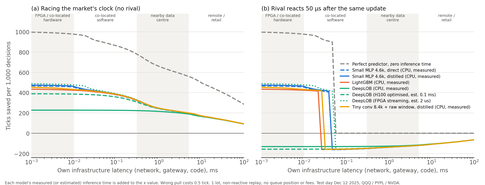

# DeepLOB on Nasdaq ITCH (event-time target)

*2026-11-16. Code: `code/models/train_deeplob_itch.py`, `code/sim/latency_sim.py`. Raw numbers:
`deeplob_itch/metrics.json`, `sim/latency_sim.json`.*

## Setup

- **Task:** direction of the next mid-price change, predicted at every best bid/ask update (thinned to
  <= 300k rows per stock-day). QQQ, PYPL, NVDA pooled. Train Dec 8-10 2025 (2.37M rows), validate Dec 11
  (early stopping only), test Dec 12 (847k rows). Same rows and labels as the feature models.
- **DeepLOB input:** the last 100 book updates x 40 values (10 levels), z-scored per stock with the previous
  day's statistics (paper's LSE setup); prices stored as exact ticks. Paper-size model (61.6k params).
- **Training:** Adam (lr 0.01, epsilon 1), batch 64, early stopping on validation accuracy (patience 4).
  10 epochs, best at epoch 6, ~2 h on an M1 Max GPU.

## Accuracy (test day)

| Model | Input | Accuracy | AUC | Log-loss | Batch-1 inference (CPU) |
|---|---|---|---|---|---|
| Queue-imbalance rule | 1 feature | 0.626 | – | – | ~0.5 us |
| Logistic regression | 34 features | 0.638 | 0.689 | 0.638 | ~1 us |
| Small MLP, direct (4.6k) | 34 features | 0.657 | 0.721 | 0.613 | 10 us |
| LightGBM | 34 features | 0.663 | **0.728** | **0.608** | 27 us |
| **DeepLOB** (61.6k) | raw 100 x 40 book | **0.663** | 0.726 | 0.611 | **1,764 us** |
| Average of DeepLOB and LightGBM | both | 0.671 | 0.738 | – | – |

Paired block bootstrap (1-minute blocks, 1,000 resamples), accuracy differences:
DeepLOB - small MLP **+0.66 pts [+0.50, +0.82]**; DeepLOB - LightGBM +0.03 [-0.12, +0.18];
LightGBM - small MLP +0.63 [+0.52, +0.74]. Per stock (DeepLOB): QQQ 0.673, NVDA 0.663, PYPL 0.654.

- **Gate 1 (deep model beats simple ones): narrow pass.** From the raw book alone, DeepLOB matches LightGBM on
  hand-made features and beats the small MLP by 0.66 points.
- **DeepLOB sees something the features miss.** Its P(up) correlates 0.82 with LightGBM's, and their average
  is 0.8 points better than either. That makes it a useful distillation teacher.

## With latency charged (simulator)

Ticks saved per 1,000 decisions; wrong pull costs 0.5 tick; 1 lot, non-reactive replay.

| Own infrastructure latency | 10 us | 100 us | 1 ms |
|---|---|---|---|
| Small MLP, direct (10 us) | 455 | 379 | 243 |
| LightGBM (27 us) | 424 | 380 | 247 |
| **DeepLOB, CPU (1.76 ms, measured)** | **228** | **226** | **215** |
| DeepLOB, H100 optimised (0.1 ms, estimate) | 386 | 357 | 244 |
| DeepLOB, FPGA streaming (2 us, estimate) | 476 | 389 | 247 |

- On a CPU, DeepLOB keeps about half the small MLP's value at co-located speeds, despite being more accurate.
- Only with FPGA-class inference does DeepLOB's accuracy edge turn into more value (476 vs 455).
- From ~1 ms of own latency the market's clock dominates and all models converge.
- Against a 50 us rival, CPU DeepLOB never acts first: it only pays for its wrong pulls.

## Caveats

- One test day, one seed for DeepLOB; batch 64 and patience 4 instead of the paper's 32 and 20 (run time).
- H100 and FPGA latencies are estimates, not measurements.
- The simulator isolates the latency effect; it is not a PnL estimate (no queue position, fees, or impact).
