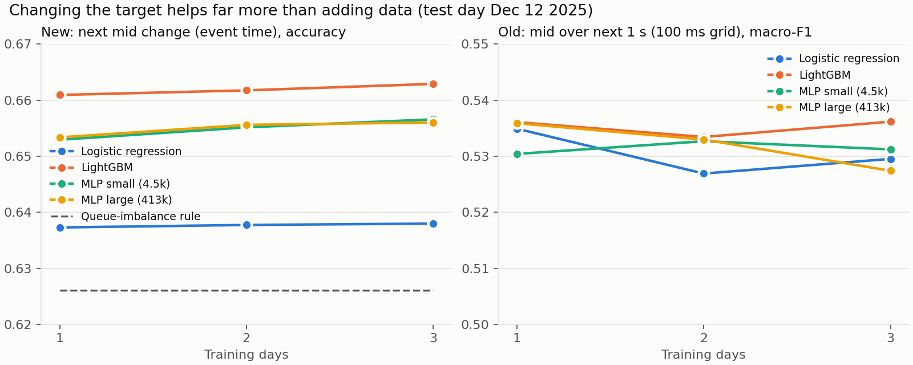

# Event-Time Target and Learning Curve

*2026-11-03. Follows [baseline_results.md](baseline_results.md). Code: `code/data/book_events.py`,
`code/data/features_event.py`, `code/models/learning_curve.py`, `code/analysis/plot_learning_curve.py`.
Raw numbers: `learning_curve/{event,grid}.json`.*

## Question

The 100 ms / 1 s baselines tied at ~0.53 macro-F1 with no gap between small and large models. Was that
(a) the target, (b) the features, or (c) too little data? This run tests (a) and (c).

## Two setups

| | Old ("grid") | New ("event") |
|---|---|---|
| Rows | every 100 ms | every best bid/ask change (last per timestamp), thinned evenly to ≤300k per stock-day |
| Label | mid change over next 1 s: down / flat / up | direction of the **next** mid change: down / up (no flat class, no horizon to pick) |
| Features | 31, windows 0.1 s – 5 min | 34, same families, windows 10 ms – 60 s (event-level order-flow imbalance, time since last move, update intensity) |
| Balance (test) | 0.33 / 0.36 / 0.31 | 0.50 up |

The next mid change comes fast: median 2–26 ms for QQQ and NVDA, 16–208 ms for PYPL. **This signal only
exists at millisecond scale, so a model is only useful if it can act within a few ms.**

Learning curve: train on 1 day (Dec 10), 2 days (Dec 9–10), 3 days (Dec 8–10); validate Dec 11; test Dec 12.

## Results, event-time target (test day Dec 12)

| Train days | Model | Accuracy | AUC | Log-loss |
|---|---|---|---|---|
| – | Queue-imbalance sign rule (1 feature) | 0.626 | – | – |
| 1 | Logistic regression | 0.637 | 0.688 | 0.638 |
| 1 | LightGBM | **0.661** | **0.724** | **0.612** |
| 1 | MLP small (4.5k) | 0.653 | 0.715 | 0.618 |
| 1 | MLP large (413k) | 0.653 | 0.716 | 0.617 |
| 3 | Logistic regression | 0.638 | 0.689 | 0.638 |
| 3 | LightGBM | **0.663** | **0.728** | **0.608** |
| 3 | MLP small (4.5k) | 0.657 | 0.721 | 0.613 |
| 3 | MLP large (413k) | 0.656 | 0.720 | 0.614 |

Per stock (LightGBM, 3 days): QQQ 0.667, PYPL 0.664, NVDA 0.658. The gain holds for every stock.
Top LightGBM features: queue imbalance, microprice deviation, 10 ms order-flow imbalance, 100 ms trade-flow
imbalance, spread, last-10-event order-flow imbalance, time since the last move.

## Results, old target (for comparison)

Macro-F1 0.527–0.536 for every model and every training size, with no trend; differences are noise.

## Answers

1. **Target, yes.** Moving to event time and the next mid change lifts accuracy from ~0.53 (directional, old)
   to **0.66**, and a nonlinear-vs-linear gap appears (LightGBM 0.663 vs logistic 0.638). There is now a
   real signal to learn.
2. **More data: a little, only for nonlinear models.** 1 → 3 days adds +0.2 pts (LightGBM) and +0.3–0.4 pts
   (MLPs); logistic is flat; the old target is flat. Curves are still rising slightly, so more days would help
   a bit, but **adding data is not where the big gains are.** Buying a month of data is not justified yet;
   the free extra ITCH days are enough for a second test set.
3. **Model size still doesn't matter.** The 413k-parameter MLP equals the 4.5k one at every training size and
   stops improving after ~6 epochs (small: ~12). LightGBM beats both MLPs by ~0.6 pts, the usual result on
   tabular features.

## Implications for the project

- **Keep the event-time target** as the main task from now on.
- **Teacher candidates:** LightGBM is currently the best model, but its lead over the 4.5k student is only
  0.6 pts (0.663 vs 0.657). See "Teacher and student inputs" below for how we widen it without breaking the
  experiment.
- **Latency is now central:** with a median 2–26 ms to the next mid change, a model that takes even 1 ms
  to act loses a meaningful share of its predictions. That is the latency-vs-accuracy trade-off the
  project is about.

## Teacher and student inputs (decided 2026-11-03)

Distillation compares models given the **same information**; the teacher's advantage must come from capacity,
not from seeing more. Concretely:

- **Same information, different processing budget.** Both see the last N book updates. The teacher
  (DeepLOB / Transformer) reads the full raw window (e.g. 100 updates x 40 values) and takes 100s of µs; the
  student reads a few summary features computed from the same window and runs in ~1 µs. Whether the big model
  extracts more from the raw window is gate 1, still untested (so far only hand-made features were tried).
- **Cross-asset lead–lag features (QQQ top holdings) go to both models.** They are cheap to compute (a basket
  return is nanoseconds), so withholding them from the student would be an unfair comparison. Expected to
  raise every model, not to create a teacher–student gap.
- **Privileged-information teacher** (Lopez-Paz et al. 2015; plan item D4), where the teacher sees data the
  student cannot use at decision time, is a different experiment. We have no natural case of data that is
  genuinely unusable in time, so at most it is a clearly labelled side ablation.
- **If the teacher still does not beat the student**, that is reported as the result: a cache-sized model
  matches a much larger one at 50-100x lower latency. Distillation can still help with a small lead, by
  giving smoother targets than raw up/down labels, by labelling extra days (D5) and through a
  latency-matched teacher (D6).

## Next steps

1. Reproduce DeepLOB on FI-2010 (anchor-paper result; data downloaded).
2. Train DeepLOB on the event-time ITCH data (raw window of recent book updates) as the capacity teacher.
3. Add QQQ top-holdings lead–lag features to every model (re-parse 8 symbols for days 2–5, ~5 min/day).
4. Distil LightGBM / DeepLOB into the 4.5k student (D1 soft labels, D2 regression, D5, D6); measure
   batch-1 latency of every model, the student in C.
5. Trading evaluation in hftbacktest with a latency sweep.

## Caveats

- One test day; the per-model differences in the event setup (~0.5–2.5 pts on ~850k rows) are far larger
  than sampling noise on that day, but day-to-day variation is untested.
- Rows are sampled at book updates, which over-weights busy periods; the trading simulation will judge the
  model at its actual decision times.
- Nasdaq-only book.
